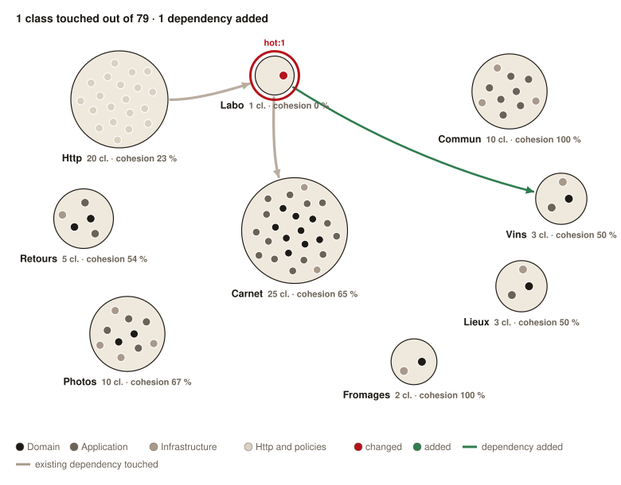

# What moved

Reviewing a pull request written by an AI starts with understanding what it moved. This action comments on the pull request with a map of the project's contexts: each class is a dot, red when the pull request changed it, green when it added it, with only the dependencies the pull request touches. You know where to look before opening the diff.



Here, the pull request changes the only class of `Labo` and makes it depend on `Vins`: the new dependency is drawn in green, and the existing ones of the changed class in grey. Every other relation of the project stays off the map.

The comment gives the figures, the image, and a link to a report to explore every class and its dependencies.

## Usage

```yaml
name: What moved

on: pull_request

permissions:
  contents: write
  pull-requests: write

concurrency:
  group: what-moved-${{ github.event.pull_request.number }}
  cancel-in-progress: true

jobs:
  graph:
    runs-on: ubuntu-latest
    steps:
      - uses: DeGraciaMathieu/what-moved@v1
```

The inputs and their defaults are described in `action.yml`.

## Contexts and layers

The context of a class is the segment after the root namespace: `App\Carnet\Domain\Fondue` belongs to `Carnet`. The next segment gives the layer, `Domain`, `Application` or `Infrastructure`, and `application` by default. Every class of the contexts listed in `web` falls in the web layer.

A class uses another one when its name appears in the code once resolved: a type, a `new`, a static call, an `instanceof`, an attribute, a `::class`. Imports alone and docblocks do not count.

## The map

The `positions` file places each context, so the map stays the same from one pull request to the next. A missing context goes next to the one it shares the most dependencies with.

```json
{
    "Http": [150, 125],
    "Carnet": [370, 290]
}
```

## Publishing

The image is committed to an orphan branch of the repository, `what-moved-assets` by default, one file per pull request, overwritten at each run. The comment links it through `github.com/<owner>/<repo>/raw/<commit>/...`, so it shows to whoever can read the repository, private or not, and never from a stale cache. This is why the action needs `contents: write`.

The report is kept as an artifact of the run: the comment links it, and it opens once downloaded.
