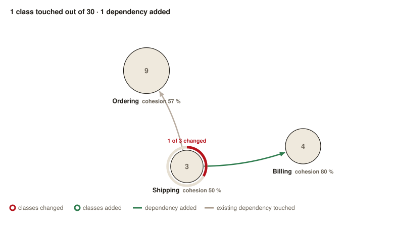
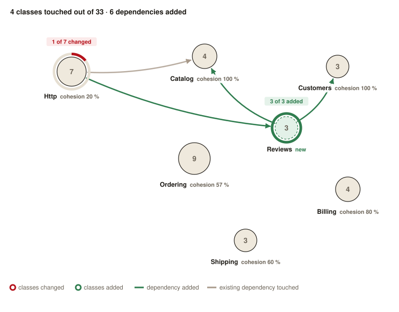
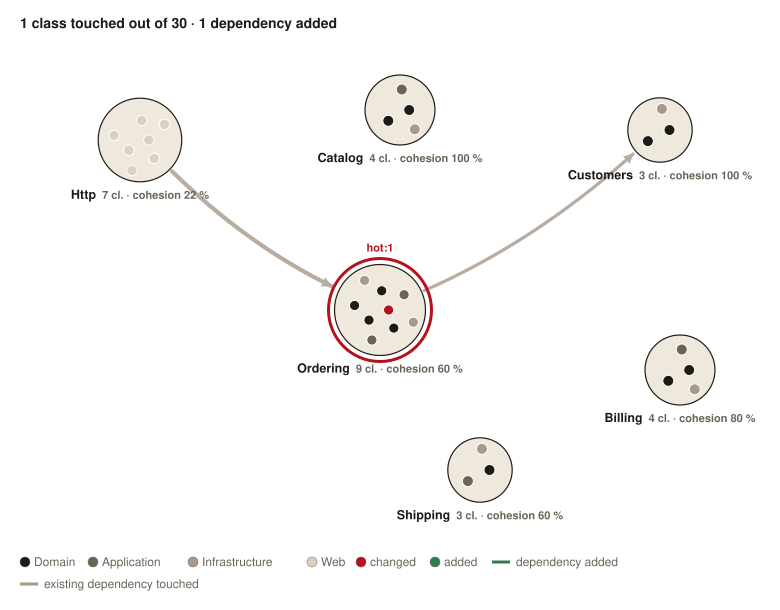
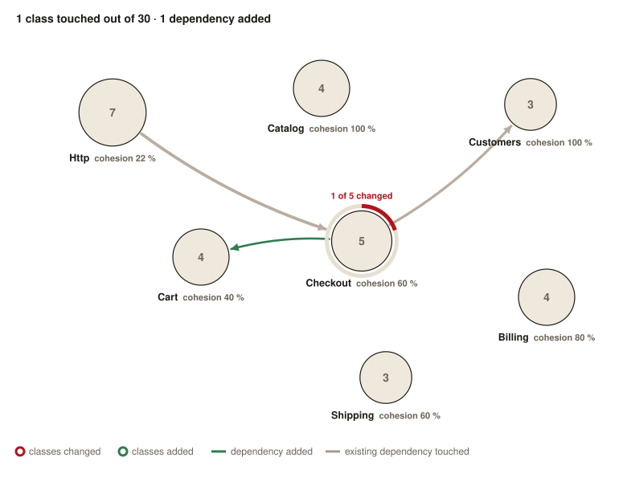

# What moved

Reviewing a pull request written by an AI starts with understanding what it moved. This action comments on the pull request with a map of the project's contexts: each context is a circle sized by its classes, ringed by the share of them the pull request changed or added, with only the dependencies the pull request touches. You know where to look before opening the diff.



Here, the pull request changes one of the three classes of `Shipping` and makes it depend on `Billing`: the new dependency is drawn in green, the existing ones of the changed class in grey. Every other relation of the project stays off the map.

## The comment

The action posts one comment on the pull request and updates it at each push:

```markdown
### What moved

**0** classes added, **1** changed, **0** removed, out of 30 · **1** dependency added, **0** removed.

Contexts touched: `Shipping` (1).


[Explore every class](https://github.com/acme/shop/actions/runs/…/artifacts/…): download the report, then open `report.html`.
```

The report holds the same map, then every class of the project as a dot: click one to see what it depends on and what uses it.

## Reading the map

- A **circle** is a context, sized by its number of classes, written at its centre. Under its name, `cohesion` is the share of its dependencies that stay inside it.
- A **gauge** rings a context the pull request touched: the red arc covers the share of its classes the pull request changed, the green one the share it added, as written above it (`1 of 3 changed`).
- A **green arrow** is a dependency the pull request added, as thick as the number of dependencies it added between the two contexts. A **grey arrow** is an existing dependency from or to a touched class.
- A **dashed green circle** is a context the pull request created:



## Usage

```yaml
name: What moved

on: pull_request

permissions:
  contents: write
  pull-requests: write

concurrency:
  group: what-moved-${{ github.event.pull_request.number }}
  cancel-in-progress: true

jobs:
  graph:
    runs-on: ubuntu-latest
    steps:
      - uses: DeGraciaMathieu/what-moved@v4
```

| Input | Default | |
|---|---|---|
| `source` | `app` | Folder of the classes to map, from the project root. |
| `namespace` | `App` | Root namespace of the classes in the folder. |
| `config` | `.github/what-moved.json` | Config file of the contexts, see below. |
| `assets-branch` | `what-moved-assets` | Orphan branch that keeps the image of each pull request. |
| `php-version` | `8.2` | PHP version that runs the analysis. |
| `github-token` | `${{ github.token }}` | Token that pushes the image and posts the comment. |

## Configuration

The config file sets the contexts and their place on the map. Every key is optional: without a file, each first segment of the namespace is a context. Placing the contexts is what makes the map readable, though: see [Positions](#positions).

```json
{
    "contexts": {
        "Http":     { "prefixes": ["Http", "Policies"], "position": [140, 140] },
        "Catalog":  { "position": [400, 110] },
        "Ordering": { "position": [380, 310] },
        "Billing":  { "position": null }
    },
    "exclude": ["Providers"]
}
```

### Contexts

The context of a class is found from its name without the root namespace:

- the context whose prefix, among the `prefixes` of `contexts`, is the longest to match the class: `App\Policies\OrderPolicy` belongs to `Http` above;
- or else the first segment: `App\Catalog\Domain\Product` belongs to `Catalog`.

A context without `prefixes`, like `Catalog` above, is still found by its first segment: declaring it only places it on the map. The classes that match a prefix of `exclude` stay off the map.

### Positions

The `position` of a context places it on a 780 by 610 map, so the map stays the same from one pull request to the next. A context without a position, or with a null one, goes next to the placed context it shares the most dependencies with; with no placed neighbour, it goes to the middle of the map, where the unplaced contexts pile up. Place every context once, and leave a null position to the ones still moving.

## Recipes

### A Laravel project

List the contexts of `app/` with a place on the map, merge the policies into the controllers, and leave the service providers out, since they depend on everything:

```json
{
    "contexts": {
        "Http":   { "prefixes": ["Http", "Policies"], "position": [150, 150] },
        "Models": { "position": [400, 300] },
        "Jobs":   { "position": [620, 150] }
    },
    "exclude": ["Providers"]
}
```

### Split a context too big to read

In one `Ordering` context, a pull request that makes the checkout depend on the cart only shows 1 of 9 classes changed: the dependency stays inside the circle.



Declare its modules as contexts of their own:

```json
{
    "contexts": {
        "Cart":     { "prefixes": ["Ordering\\Cart"], "position": [250, 320] },
        "Checkout": { "prefixes": ["Ordering\\Checkout"], "position": [450, 300] }
    }
}
```

The same pull request now shows the new dependency from `Checkout` to `Cart`:



### Code outside `app/`

For classes in `src/` under `Acme\`:

```yaml
      - uses: DeGraciaMathieu/what-moved@v4
        with:
          source: src
          namespace: Acme
```

## Dependencies

A class uses another one when its name appears in the code once resolved: a type, a `new`, a static call, an `instanceof`, an attribute, a `::class`. Imports alone and docblocks do not count. Only the classes of `source` are mapped: a dependency to a vendor class is left out.

## Publishing

The image is committed to an orphan branch of the repository, `what-moved-assets` by default, one file per pull request, overwritten at each run. The comment links it through `github.com/<owner>/<repo>/raw/<commit>/...`, so it shows to whoever can read the repository, private or not, and never from a stale cache. This is why the action needs `contents: write`.

The report is kept as an artifact of the run: the comment links it, and it opens once downloaded.
